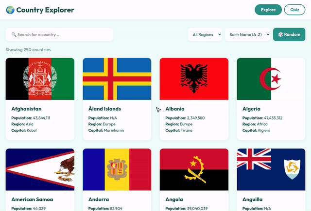

# 🌍 Country Explorer

I wanted to learn more about countries (and get better at flags 😅), so I made this. You can look up any country and then play a quiz to test yourself.

---

## 🔎 Explore

| What | How |
|---|---|
| Search | type any country name |
| Filter | pick a region (Asia, Europe, Africa...) |
| Sort | by name, population or area |
| Details | click a card to see capital, languages, currencies, area and more |
| Neighbours | click a border country to jump to it |
| Feeling lucky? | 🎲 random country button |

## 🧠 Quiz

Two modes:
- 🏳️ **Guess the Flag**
- 🏛️ **Guess the Capital**

Each round is 10 questions with 4 options. Green = right, red = wrong. There's a score, a 🔥 streak and your best score is saved so you can try to beat it.

### How the quiz works

There is no quiz API, I made the questions from the country data:

1. shuffle all countries and take 10
2. for each one, the right answer is its name (or capital)
3. pick 3 random other countries as wrong answers
4. shuffle the 4 options and show them

## 🛠️ Built with

- HTML
- CSS (grid + flexbox)
- JavaScript (fetch, filter, sort, localStorage)

Data from:
- [mledoze/countries](https://github.com/mledoze/countries) - country info
- [World Bank API](https://datahelpdesk.worldbank.org/knowledgebase/articles/889392) - population
- [flagcdn.com](https://flagcdn.com) - flag images

## ▶️ Run it

No install needed, just open `index.html` in your browser.

## 📝 What I learned

- getting data from 2 different APIs and joining them together
- using `.filter()` and `.sort()` on big arrays
- making a quiz with random questions and answers
- switching between pages without reloading
